# GymSystem — Diagrama Entidade-Relacionamento

Gerado a partir do [`schema.sql`](schema.sql). O GitHub, o VS Code (extensão *Markdown Preview Mermaid
Support*) e o site <https://mermaid.live> desenham o diagrama automaticamente.

## Como ler as linhas (notação "pé de galinha")

| Símbolo | Significa |
|---|---|
| `\|\|` | exatamente 1 |
| `o\|` | 0 ou 1 |
| `\|{` | 1 ou mais |
| `o{` | 0 ou mais |

Exemplo: `usuarios ||--o{ historico_treinos` = **um** usuário tem **zero ou mais** treinos no histórico,
e cada treino do histórico pertence a **exatamente um** usuário.

`PK` = chave primária · `FK` = chave estrangeira · `UK` = valor único (UNIQUE)

## Diagrama completo

```mermaid
erDiagram
    %% ---------------- pessoas e gamificação
    usuarios ||--o{ sessoes : "está logado em"
    usuarios ||--o| perfis : "tem perfil de jogo"
    categorias_ranking ||--o{ perfis : "agrupa no ranking"
    usuarios ||--o{ configuracoes_usuario : "personaliza"
    opcoes_configuracao ||--o{ configuracoes_usuario : "define a chave"

    %% ---------------- treinos
    treinos ||--|{ treino_exercicios : "é composto de"
    exercicios ||--o{ treino_exercicios : "aparece em"
    usuarios ||--o{ historico_treinos : "conclui"
    treinos ||--o{ historico_treinos : "é registrado em"
    usuarios ||--o{ recordes : "bate"
    exercicios ||--o{ recordes : "em"

    %% ---------------- conquistas
    usuarios ||--o{ usuario_titulos : "libera"
    titulos ||--o{ usuario_titulos : "é liberado em"

    %% ---------------- social
    usuarios ||--o{ duelos : "desafia (desafiante_id)"
    usuarios ||--o{ duelos : "é desafiado (desafiado_id)"
    desafios ||--o{ participacoes : "tem"
    usuarios ||--o{ participacoes : "participa"

    %% ---------------- administração
    usuarios ||--o{ matriculas : "contrata"
    planos ||--o{ matriculas : "é contratado em"
    matriculas ||--o{ pagamentos : "gera"

    usuarios {
        int id PK
        varchar nome
        varchar email UK
        varchar senha_hash "hash, nunca a senha"
        enum papel "aluno | admin"
        char cpf UK "NULL para admin"
        date criado_em
    }
    sessoes {
        char token_hash PK "SHA-256 do token, nunca o token"
        int usuario_id FK
        datetime criada_em
        datetime expira_em
    }
    perfis {
        int usuario_id PK, FK
        int nivel
        int xp "0 a 2999 dentro do nível"
        int sequencia
        int melhor_sequencia
        int treinos_feitos
        date ultimo_treino
        int frequencia_ativos
        int frequencia_meta
        char frequencia_mes "AAAA-MM"
        varchar categoria_ranking FK
        varchar emoji
    }
    categorias_ranking {
        varchar nome PK
        tinyint ordem
    }
    opcoes_configuracao {
        varchar chave PK
        varchar rotulo
        boolean padrao
        tinyint ordem
    }
    configuracoes_usuario {
        int usuario_id PK, FK
        varchar chave PK, FK
        boolean valor
    }
    treinos {
        char codigo PK "A, B, C"
        varchar nome
        varchar grupo
        int minutos
        int xp
    }
    exercicios {
        int id PK
        varchar nome UK
        varchar grupo
    }
    treino_exercicios {
        char treino_codigo PK, FK
        tinyint ordem PK
        int exercicio_id FK
        tinyint series
        tinyint reps
        decimal carga
    }
    historico_treinos {
        int id PK
        int usuario_id FK
        char treino_codigo FK
        date data
        int minutos
        int exercicios
        int xp
    }
    recordes {
        int id PK
        int usuario_id FK
        int exercicio_id FK
        decimal carga
        date data
    }
    titulos {
        int id PK
        varchar icone
        varchar nome UK
        varchar descricao
    }
    usuario_titulos {
        int usuario_id PK, FK
        int titulo_id PK, FK
        date liberado_em
    }
    medalhas {
        int id PK
        varchar icone
        varchar nome UK
        varchar descricao
        int meta
        enum contador "qual número do perfil conta"
    }
    duelos {
        int id PK
        int desafiante_id FK
        int desafiado_id FK
        varchar objetivo
        int dias
        enum status "pendente | ativo | recusado | encerrado"
        date criado_em
        date inicio
        date termina_em
        int xp_desafiante
        int xp_desafiado
    }
    desafios {
        int id PK
        varchar nome
        varchar meta
        int recompensa_xp
        int treinos_meta
        date inicio
        date termina_em
    }
    participacoes {
        int desafio_id PK, FK
        int usuario_id PK, FK
        date entrou_em
    }
    desafios_academia {
        int id PK
        varchar icone
        varchar nome
        varchar descricao
        int xp
        enum status "Pendente | Finalizado"
    }
    planos {
        int id PK
        varchar nome UK
        decimal preco
        int duracao_meses
    }
    matriculas {
        int id PK
        int usuario_id FK
        int plano_id FK
        decimal valor_mensal
        date data_inicio
        date vencimento
        boolean ativo
        date cancelada_em
    }
    pagamentos {
        int id PK
        int matricula_id FK
        date referencia "1º dia do mês"
        decimal valor
        date vencimento
        date pago_em "NULL = pendente"
    }
```

`medalhas` e `desafios_academia` aparecem soltas porque são **catálogos**, iguais para todos os alunos.
O progresso de cada medalha é calculado no `gamificacao.py` a partir dos números do perfil.

## Pontos para explicar na apresentação

1. **Usuário x membro.** Não existe tabela "membros". Um membro do painel é um `usuarios` com
   `papel = 'aluno'` + uma linha em `matriculas`. Assim, login, ranking e painel mostram a mesma pessoa.
2. **1:1 (`usuarios` — `perfis`).** A PK de `perfis` também é FK para `usuarios`, por isso um usuário
   tem no máximo um perfil. O admin não tem perfil.
3. **N:N com tabela associativa.** `treino_exercicios` (treino ↔ exercício), `usuario_titulos`
   (aluno ↔ título) e `participacoes` (aluno ↔ desafio). As PKs são compostas, então a mesma ligação
   não pode se repetir.
4. **Duas FKs para a mesma tabela.** `duelos` aponta duas vezes para `usuarios` (desafiante e desafiado).
   Convite e duelo são a mesma linha em momentos diferentes (`status`).
5. **Calcular em vez de guardar.** Receita, inadimplência, alunos ativos por plano, vencimentos, recorde
   atual e gráfico de evolução não são colunas: são calculados com `SUM`, `COUNT` e `MAX` sobre
   `pagamentos`, `matriculas` e `recordes`. Assim nunca ficam desatualizados.
6. **Desnormalização consciente.** `perfis.treinos_feitos` e `perfis.sequencia` poderiam ser contados
   do histórico, mas são guardados porque as regras de gamificação os calculam e gravam, e o histórico
   antigo não existe por completo.
7. **CPF em `usuarios`.** O CPF é da pessoa. Se ficasse em `matriculas`, ele se repetiria a cada
   renovação de contrato.
8. **Sessões com hash.** `sessoes` guarda o SHA-256 do token de login, nunca o token. Assim,
   uma cópia vazada da tabela não permite entrar no sistema. Como as sessões ficam no banco,
   reiniciar o servidor não desloga ninguém, e o logout apaga a linha.
9. **ON DELETE.** Dados "da pessoa" (perfil, histórico, recordes) usam `CASCADE`. Dados financeiros
   (`matriculas`, `pagamentos`) usam `RESTRICT`: o banco impede apagar um aluno que tenha contrato.
